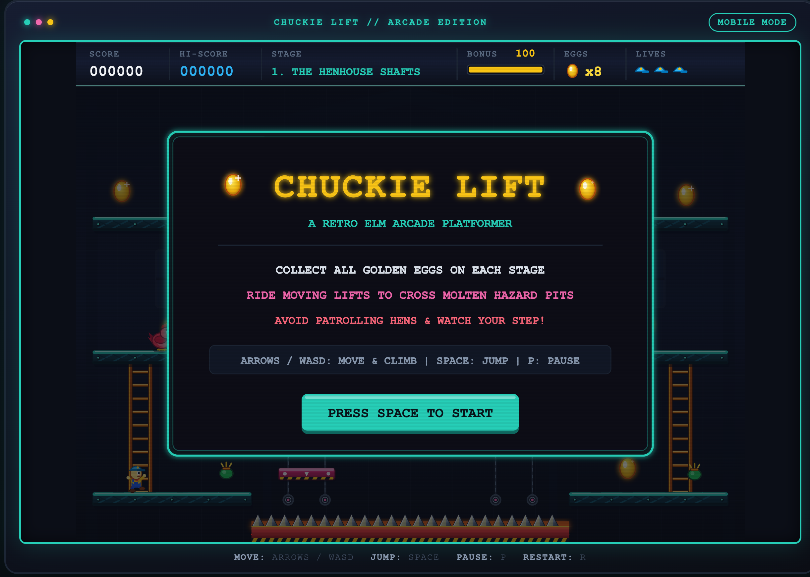
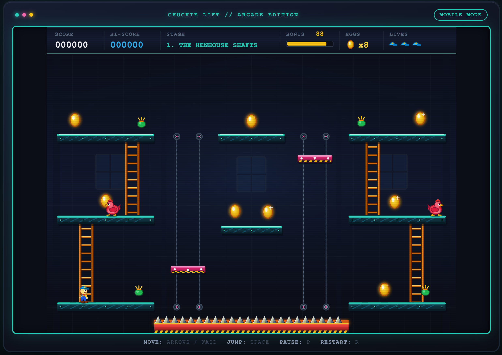

# Chuckie Lift

A retro *Chuckie Egg*–inspired 2D platformer built in **Elm** (`0.19.3`) using pure SVG rendering.

## Screenshots

### Title Screen


### Gameplay — Stage 1: The Henhouse Shafts


## Gameplay

- Collect all golden **eggs** (`+100` pts) and bonus **seeds** (`+50` pts) on each level before the bonus timer runs out.
- **Moving lifts** carry you across chasms and up to isolated platforms—you must time your jumps onto the lifts to avoid falling into the hazard pits below.
- Avoid patrolling **hens**. Missing a lift, hitting a hazard pit, touching a hen, or running out of time costs a life.
- Includes 3 handcrafted levels (*The Henhouse Shafts*, *Double Elevator*, and *The Sky Coop*) that loop with increasing speed.

## Controls

| Key | Action |
| --- | --- |
| `ArrowLeft` / `ArrowRight` or `A` / `D` | Move left / right |
| `ArrowUp` / `ArrowDown` or `W` / `S` | Climb ladders |
| `Space` or `Z` | Jump |
| `P` or `Esc` | Pause / Resume |
| `R` | Restart game |

## Run Locally

Requires `elm` (or `npx` via Node.js) and `python3`:

```sh
./run.sh
```

This compiles `src/Main.elm` to `main.js`, starts a local server on `http://localhost:8000` (override with `PORT=8080 ./run.sh`), and opens it in your browser.

## Project Structure

- `src/Main.elm` — `Browser.element` entry point and subscriptions
- `src/Types.elm` — Game state, entities, and message types
- `src/Levels.elm` — Level definitions (platforms, ladders, lifts, hazards, collectibles, enemies)
- `src/Update.elm` — Physics, lift-riding, ladder climbing, collisions, and level progression
- `src/View.elm` — Pure SVG renderer and HUD/overlays
- `index.html` — Host HTML page
- `run.sh` — Local build & serve script
- `.github/workflows/deploy.yml` — GitHub Pages deployment workflow

## Deployment

Pushing to `main` triggers [.github/workflows/deploy.yml](.github/workflows/deploy.yml), which builds `src/Main.elm` with `--optimize` and deploys to GitHub Pages. Make sure **Settings → Pages → Source** is set to **GitHub Actions** in your repository.
